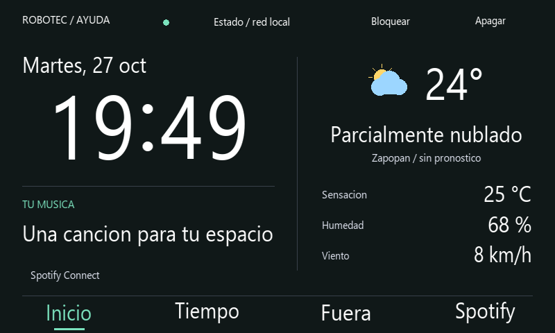
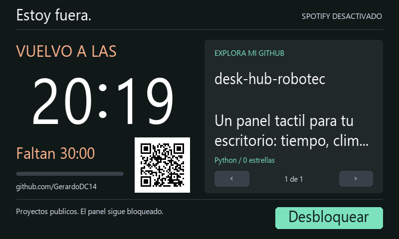
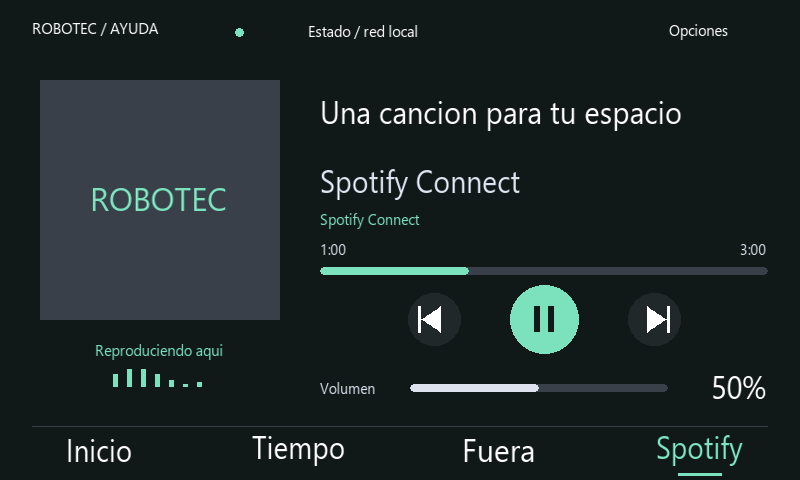
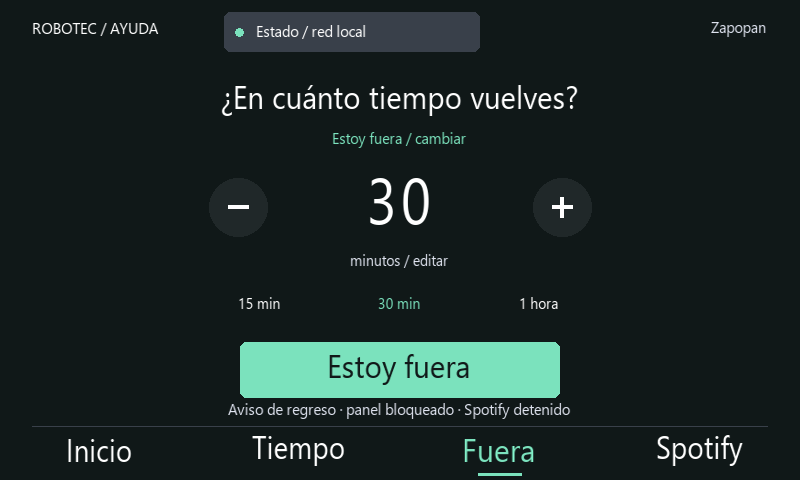
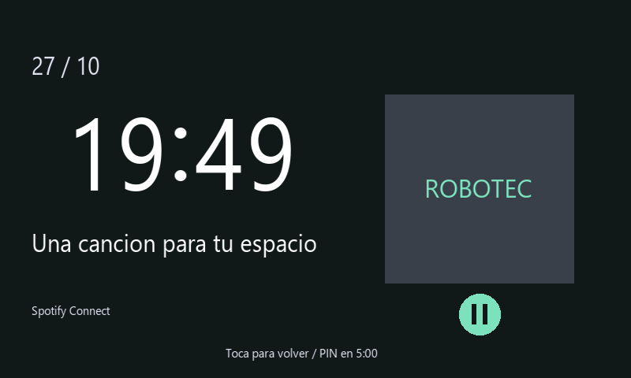

# Desk Hub Robotec

Panel táctil con **Raspberry Pi 3 B y Nextion Enhanced de 7 pulgadas**: hora, clima, temporizadores, proyectos públicos de GitHub y música por Spotify Connect.

La Pi mantiene el estado, consulta internet y reproduce audio por su jack. Nextion dibuja la interfaz y envía toques mediante un adaptador USB–TTL CH340G.



Vista reconstruida desde los comandos de dibujo, con datos de demostración y tipografía aproximada. La tipografía física es la incorporada en el HMI.

## Funciones

- **Inicio:** reloj, fecha, temperatura y datos actuales; un toque alterna un pronóstico de tres horas. Las cuentas en curso se pueden abrir desde su tarjeta.
- **Tiempo:** Temporizador con presets de Enfoque/Descanso, Cronómetro con reloj analógico y vueltas, y Alarma local de una ejecución.
- **Fuera:** hora de regreso grande, cuenta restante, proyectos públicos con navegación y QR al perfil de GitHub. Al iniciar, bloquea y detiene Spotify.
- **Spotify:** portada progresiva, canción, artista, contexto, siguiente tema, avance al tocar la barra, aleatorio, repetición y volumen directo. Controles con iconos, barra de volumen, colores de portada, desplazamiento de títulos largos y estados de conexión.
- **PIN:** seis dígitos configurados localmente; tres intentos fallidos suspenden el teclado treinta segundos.
- **Pantalla y bloqueo:** vista ambiental tras un tiempo de inactividad configurable, seguida de bloqueo con PIN después de otro intervalo. La vista ambiental muestra hora, música y la cuenta de tiempo activa.
- **Estado:** conexión local, salida de audio, Spotify, pantalla y reconexión manual del receptor.
- **Uso compartido:** guía accesible sin desbloquear, bloqueo por inactividad y confirmación antes de interrumpir música mediante reconexión.
- **Persistencia:** SQLite conserva las cuentas entre reinicios.

## Requisitos

| Elemento | Configuración de referencia |
|---|---|
| Raspberry Pi | Pi 3 Model B, Raspberry Pi OS Lite 64 bits, Debian Trixie |
| Pantalla | Nextion Enhanced **NX8048K070_011C**, 800 × 480 horizontal |
| Serial | USB–TTL CH340G, UART 8N1 sin control de flujo |
| Audio | Parlantes amplificados al jack de 3,5 mm de la Pi |
| Energía | Pi con fuente adecuada; Nextion con fuente externa de 5 V / 2 A y tierra común |
| Red | Wi-Fi o Ethernet para las integraciones |
| Música | Spotify Premium y credencial propia de Spotify Soloist |

El TFT incluido corresponde al modelo identificado **NX8048K070_011C**. Nextion Editor presenta la familia NX8048K070_011. No cargar en otra serie o resolución.

## Instalación

```sh
git clone https://github.com/GerardoDC14/desk-hub-robotec.git ~/desk-hub
cd ~/desk-hub
sudo apt update
sudo apt install python3 python3-pil python3-qrcode pulseaudio pulseaudio-utils alsa-utils
python3 pin_setup.py
python3 robotec.py --self-test
```

Continúa con [Instalación y servicios](docs/INSTALACION.md), [Firmware Nextion](docs/NEXTION.md) y [Spotify y audio](docs/SPOTIFY.md). Esas guías cubren conexiones, permisos y arranque automático.

## Uso

La interfaz usa fondo grafito, texto blanco de alto contraste y navegación grande. El brillo normal es del 100 %; el brillo de la vista ambiental se ajusta entre 20 y 100 %, con 60 % de forma predeterminada. Los reflejos del cristal y el ángulo de visión pueden seguir afectando la lectura; orienta la pantalla para evitar luces reflejadas directamente.

Al encender el panel queda bloqueado; si hay una salida pendiente, conserva su aviso público. Introduce tu PIN y pulsa Entrar; no se distribuye un PIN predeterminado. Ayuda abre una guía local sin habilitar Spotify ni revelar el PIN. Desde las vistas normales, toca ROBOTEC / AYUDA. El panel reintenta la conexión si enciendes Nextion después de la Pi.

En **Tiempo**, elige Temporizador, Cronómetro o Alarma. El temporizador ofrece accesos a 5 minutos de descanso, 25 de enfoque y una hora. Los controles − y + ajustan un minuto por toque, entre 1 minuto y 24 horas. Toca la cifra para introducir directamente de 1 a 1440 minutos y pulsa Guardar. Iniciar amplía la cuenta; Pausar o Reiniciar regresa a los ajustes. Inicio vuelve a la portada sin detener el temporizador o cronómetro; toca su tarjeta para recuperarlo. Tiempo y Fuera comparten una cuenta regresiva: elegir una duración nueva sustituye la anterior. El cronómetro es independiente y conserva las cinco últimas vueltas.

La **Alarma** se programa para la próxima ocurrencia de una hora local. Toca las horas o los minutos y usa −/+; la barra ajusta el volumen propio del aviso. El sonido se repite hasta Detener o Posponer 5 min, con un límite de tres minutos. Probar sonido dura cinco segundos. El temporizador usa un sonido diferente y avisa durante un máximo de treinta segundos. Durante el aviso se atenúa el flujo de música y se restaura al detenerlo o terminar; un cambio manual de volumen se respeta. Silenciar detiene el sonido y mantiene el aviso visible; Detener lo cierra. Las cuentas independientes siguen su curso. Los avisos no desbloquean el panel ni activan Spotify. La Pi debe estar encendida y el servicio activo; no es un despertador que arranque la Pi apagada. Consulta [Tiempo y avisos](docs/TIEMPO.md).

En **Fuera**, elige 15, 30 o 60 minutos, ajusta la duración con −/+ o toca la cifra para escribirla. Toca el motivo para elegir Estoy fuera, En reunión o En el laboratorio; pulsa Estoy fuera para iniciar. Permanecen visibles la cuenta, hora de regreso y proyectos públicos. Se detiene Spotify y el acceso vuelve a exigir PIN. Pulsa **Desbloquear** e introduce el PIN correcto al regresar: se termina la salida y se restablece su duración para preparar la siguiente desde Fuera. Abrir el teclado o introducir un PIN incorrecto mantiene la cuenta. **Ver aviso de regreso** vuelve a la vista pública sin desbloquear. Las flechas cambian de proyecto; el cambio automático ocurre cada 18 segundos. El QR abre el perfil público de GitHub en el teléfono. Al vencer la cuenta aparece Regreso pendiente, conserva la hora prevista y sigue bloqueado hasta introducir el PIN correcto.



Vista reconstruida con datos de demostración y tipografía aproximada.

Para escuchar música, desbloquea y selecciona **Desk Hub Robotec** en Dispositivos disponibles de Spotify. Toca la barra superior para saltar a una posición y la inferior para cambiar el volumen directamente. Los iconos controlan anterior, pausa/reproducción y siguiente. En Opciones están Aleatorio, Repetir y el siguiente tema, cuando Soloist lo proporciona. Desde Opciones puedes abrir Pantalla y bloqueo para ajustar la vista ambiental y cuándo debe pedir nuevamente el PIN. La pantalla distingue espera, sincronización, carga y reproducción local. Los controles esperan a que el Hub sea el dispositivo activo y tenga un estado completo. Controla desde teléfono o pantalla. Bloquear, iniciar Fuera o perder comunicación con la pantalla detiene el receptor.





Vistas reconstruidas con datos de demostración y tipografía aproximada.

Toca **Estado** en el encabezado para revisar la red local, audio, Spotify y pantalla. **Reconectar Spotify** pide confirmación si hay música o carga activa, reinicia el receptor y descarta órdenes pendientes; después selecciónalo de nuevo desde el teléfono. Abre **Estado → Pantalla y bloqueo** para ajustar los dos tiempos y el brillo ambiental. Con los valores predeterminados, tras **1 minuto sin tocar la pantalla** aparece la vista ambiental y, después de **5 minutos más sin tocarla**, se bloquea el Hub y se detiene Spotify. Tocar la pantalla reinicia la inactividad; los cambios desde Spotify en el teléfono no la reinician. **Ver ahora** abre la vista ambiental de inmediato. El temporizador, cronómetro y alarmas conservan sus estados al bloquear. Consulta [Experiencia y recuperación](docs/EXPERIENCIA.md) y [Uso compartido](docs/USO_COMPARTIDO.md).



Vista reconstruida con datos de demostración y tipografía aproximada.

Para desconectar, toca **Apagar** en la esquina superior de Inicio y confirma si habilitaste el permiso opcional, o ejecuta `sudo systemctl poweroff` por SSH. Espera al apagado antes de quitar energía; no cortes alimentación durante una carga TFT o escritura en microSD.

## Configuración y funcionamiento

`.env.example` permite seleccionar puerto serial, perfil público de GitHub, ubicación del clima y nombre del receptor. La configuración real, PIN, claves y SQLite permanecen fuera del repositorio. El PIN restringe el panel y la disponibilidad de Spotify; no sustituye la seguridad de SSH y de la red.

- [Arquitectura y límites](docs/ARQUITECTURA.md)
- [Diagnóstico](docs/DIAGNOSTICO.md)
- [Nextion: edición y actualización](docs/NEXTION.md)

`inactivity.py` define los tiempos, el bloqueo por inactividad y el brillo; `friendly_ui.py` aporta la guía y la navegación compartida; `weather_data.py` resume el pronóstico horario. `experience.py` gestiona la vista ambiental, el teclado de duración y el estado local; `audio_focus.py` atenúa y restaura el flujo de música durante avisos. `editorial_views.py` define la composición y las zonas visuales de Inicio, Fuera, Spotify y acceso. `soft_ui.py` aporta iconos nativos y actualizaciones por diferencias. `nextion_link.py` filtra el texto y espera la confirmación de ejecución de cada lote UART. `dashboard_views.py` y `dashboard_state.py` gestionan herramientas y alarmas. `music_client.py` recibe eventos de Soloist. `robotec.py` dibuja las vistas y procesa coordenadas de toque; `desk_hub.py` aporta UART, temporización, persistencia y consultas. El HMI editable y el TFT compilado están en `nextion/`. Modifica dibujo y zonas táctiles conjuntamente.

## Comprobaciones

```sh
python3 -m compileall -q .
python3 robotec.py --self-test
python3 -m unittest discover -s tests -v
```

Los tests cubren temporización, restauración, tramas UART, PIN, bloqueo, alarmas, posposición, avance musical, vueltas, conservación de píxeles al actualizar barras e imágenes y estabilización de la tipografía. El hardware de referencia validó UART a 115200, controles, reproducción y bloqueo de Spotify. Las rutas y servicios configurables requieren prueba de instalación en el equipo destino; los tests no verifican apagado físico ni ventilación.

El clima procede de [Open-Meteo](https://open-meteo.com/) y los proyectos de la API pública de GitHub. [Spotify Soloist](https://developer.spotify.com/documentation/soloist/reference/downloads-and-updates) se descarga por separado y conserva sus propios términos; no se incluyen ejecutables ni credenciales.
