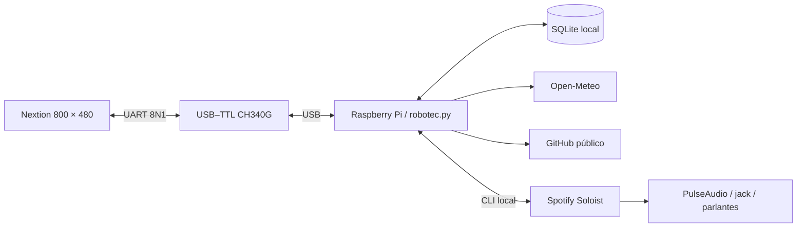

# Arquitectura y límites

## Componentes

- `robotec.py`: vistas, zonas táctiles, bloqueo, cronómetro, portadas y ciclo de vida de Spotify.
- `desk_hub.py`: puerto serial, parser de tramas, cuenta regresiva, SQLite y consultas de red.
- `soft_ui.py`: esquinas redondeadas, paneles cacheados e iconos de clima dibujados con círculos y líneas nativos.
- `settings.py`: rutas relativas al clon y variables de configuración.
- `pin_setup.py`: registro local PBKDF2-HMAC-SHA256, con sal aleatoria y comparación de tiempo constante.
- `spotify_inicio.py`: comprueba la autorización temporal y lanza Soloist con la credencial privada.
- `lock_cleanup.py`: elimina autorización y detiene Spotify al iniciar/detener el servicio del panel.

Las operaciones de red e imágenes se ejecutan en hilos. El dibujo transmite comandos Nextion terminados en `FF FF FF` y evita reenviar textos sin cambios. Se reciben coordenadas al soltar mediante `sendxy=1`. Las portadas y el avatar se convierten a 48 × 48 píxeles con una paleta reducida y se dibujan ampliados por bloques; no son imágenes de alta resolución. La portada se muestra a 192 × 192 píxeles; su carga se reparte entre refrescos para atender toques durante la transmisión. El detalle adicional aumenta el tiempo de carga frente a una imagen de 32 × 32; depende del contenido y de UART. El indicador musical animado representa actividad, no un análisis del espectro del audio. Los títulos largos se desplazan cada dos segundos.

## Datos y temporización

La cuenta guarda un instante final y se resta del reloj de Linux. El cronómetro conserva el inicio y el tiempo acumulado. Un reinicio puede incluir el tiempo que la Pi estuvo apagada; un cambio brusco de hora de Linux puede afectar esas cuentas. Los cambios se guardan en SQLite, no hay escritura por cada refresco.

Clima y GitHub se consultan aproximadamente cada diez minutos; el estado musical, cada segundo. Los límites y errores de las APIs pueden conservar información anterior o mostrar indisponibilidad. Las cuentas locales siguen funcionando sin internet.

## Bloqueo y recuperación

El servicio arranca bloqueado. El PIN correcto crea una autorización temporal en `/run/user/UID/desk-hub.unlocked`; bloquear la elimina y solicita detener el receptor. Iniciar Fuera mantiene la cuenta visible y bloquea; terminarla no autoriza Spotify.

Se consulta presencia de Nextion cada dos segundos. Se solicita bloqueo tras seis segundos sin respuesta; una desconexión USB que termine el proceso es recuperada por systemd. Un reinicio detectado de la pantalla bloquea y obliga a renegociar UART. El tiempo total de detección/recuperación depende también de operaciones de serial en curso. La pantalla puede presentar el aviso nativo de bloqueo mientras espera al servicio.

Tres PIN incorrectos producen treinta segundos de espera. Esa espera reside en memoria y se reinicia al reiniciar el proceso. El PIN protege el uso del panel: una cuenta con acceso a los archivos o comandos del mismo usuario Linux puede alterar la aplicación. No equivale a autenticación del sistema ni a aislamiento entre usuarios de Spotify Connect.

## Alcance de validación

Los autotests comprueban lógica y parser sin hardware. El apagado físico, la secuencia de alimentación, tolerancias de fuentes y la instalación en otra Pi requieren comprobación real. El proyecto usa servicios de usuario y systemd de Linux; Windows se utiliza para editar y compilar el HMI, no para ejecutar el panel conectado.
