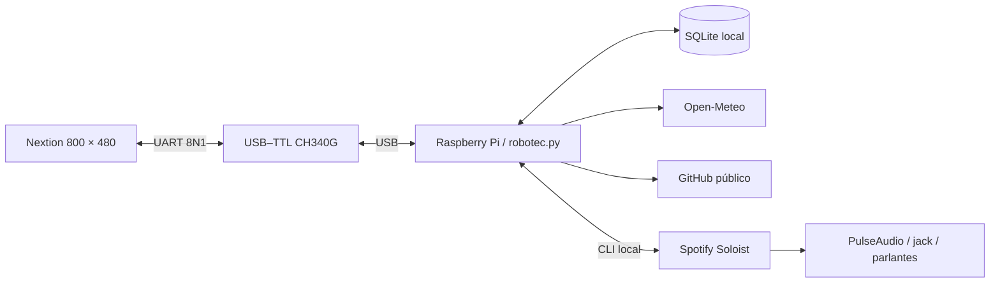

# Arquitectura y límites

## Componentes

- `editorial_views.py`: composición visual y avisos públicos, clima integrado en Inicio y QR de GitHub.
- `nextion_link.py`: normalización de texto, límites de paquetes y barrera de ejecución UART.
- `robotec.py`: vistas, zonas táctiles, bloqueo, cronómetro, portadas y ciclo de vida de Spotify.
- `desk_hub.py`: puerto serial, parser de tramas, cuenta regresiva, SQLite y consultas de red.
- `soft_ui.py`: paneles, iconos, reloj analógico y barras actualizadas por diferencias.
- `font_metrics.py`: anchos reales de las fuentes del HMI; actualízalos si sustituyes esas fuentes.
- `dashboard_views.py` y `dashboard_state.py`: herramientas de tiempo, alarma persistente, avisos y sonido local.
- `music_client.py` y `music_state.py`: suscripción local a eventos, estado musical y posición interpolada con reloj monotónico.
- `settings.py`: rutas relativas al clon y variables de configuración.
- `pin_setup.py`: registro local PBKDF2-HMAC-SHA256, con sal aleatoria y comparación de tiempo constante.
- `spotify_inicio.py`: comprueba la autorización temporal y lanza Soloist con la credencial privada.
- `lock_cleanup.py`: elimina autorización y detiene Spotify al iniciar/detener el servicio del panel.

Las operaciones de red e imágenes se ejecutan en hilos. El dibujo usa un solo escritor UART y comandos terminados en `FF FF FF`; se reciben coordenadas al soltar mediante `sendxy=1`.

Los paquetes de dibujo, incluida su barrera, no superan 256 bytes. Con `bkcmd=2`, cada lote se completa con `get sys0`: el siguiente espera la respuesta numérica y recoge los errores de las instrucciones precedentes. Los toques recibidos durante esa espera quedan pendientes para el ciclo principal. Un error o tiempo agotado interrumpe el proceso; systemd aplica el cierre del receptor y reinicia bloqueado. La barrera confirma procesamiento, no es una captura visual ni una suma de comprobación del texto dibujado.

El texto externo elimina controles, comillas dobles, barras inversas y el byte `FF`, y se limita a 160 caracteres antes de codificar. La caché considera contenido, posición, fuente y colores. Los títulos se ajustan al ancho medido y se distribuyen en dos líneas; el excedente se abrevia. El botón de acceso ocupa una zona independiente de la cuenta, el QR y los proyectos.

Las portadas se convierten a 48 × 48 píxeles con una paleta reducida y se dibujan ampliadas a 192 × 192 por bloques. Primero se transmite una vista de 12 × 12 y luego el detalle de 48 × 48. Se fusionan rectángulos iguales contiguos y se omiten píxeles ya correctos. Una caché en memoria conserva ocho portadas. El tiempo depende del contenido y UART; no se transmite vídeo ni una portada de resolución nativa completa. El indicador musical representa actividad, no un análisis del espectro de audio.

La paleta utiliza fondo grafito, texto principal blanco y texto secundario claro; la navegación y las instrucciones de acceso emplean fuentes más grandes. El brillo se ajusta con `dim=100` después de negociar UART. La paleta no modifica el acabado del cristal ni elimina los reflejos de la iluminación.

## Datos y temporización

La cuenta guarda un instante final y se resta del reloj de Linux. El cronómetro conserva el inicio, el tiempo acumulado y las cinco últimas vueltas. La alarma de una sola ejecución guarda su siguiente instante y se desactiva al dispararse. Si se recupera hasta cinco minutos tarde, se presenta el aviso; más tarde se informa que venció sin reproducir sonido. Un reinicio puede incluir el tiempo que la Pi estuvo apagada; un cambio brusco de hora de Linux puede afectar esas cuentas. Los cambios se guardan en SQLite, no hay escritura por cada refresco. Las barras y la animación musical dibujan solo sus diferencias. Las cifras grandes se actualizan por carácter; el reloj analógico borra y repone únicamente las agujas, lejos de las marcas de la esfera.

Clima y GitHub se consultan aproximadamente cada diez minutos. Inicio integra sensación térmica en °C, humedad en % y viento en km/h bajo el reloj y la temperatura. El estado sin actualizar permite reconocer un fallo de consulta conservando los últimos datos disponibles. Fuera rota repositorios cada 18 segundos y permite avanzar o retroceder manualmente. Su QR se genera localmente con python3-qrcode, apunta al perfil público configurado y no contiene credenciales. Un proceso `soloist ctl trace` entrega eventos musicales en tiempo real; una consulta cada treinta segundos mantiene una referencia de respaldo. Si el stream no está disponible, se vuelve a consultar aproximadamente cada segundo. La cola se refresca cuando llegan eventos y con una consulta de respaldo mientras la vista musical está abierta. Los límites y errores de las APIs pueden conservar información anterior o mostrar indisponibilidad. Las cuentas locales siguen funcionando sin internet.

## Bloqueo y recuperación

El servicio arranca bloqueado. El PIN correcto crea una autorización temporal en `/run/user/UID/desk-hub.unlocked`; bloquear la elimina y solicita detener el receptor. Iniciar Fuera mantiene la cuenta visible y bloquea; terminarla no autoriza Spotify. Un PIN válido indica el regreso: restablece la duración de Fuera, elimina su instante final y guarda el estado antes de activar el receptor. Un PIN incorrecto, abrir el teclado o volver al aviso público no termina la salida. Desbloquear conserva un temporizador normal en curso y el cronómetro independiente.

Se consulta presencia de Nextion cada dos segundos. Se solicita bloqueo tras seis segundos sin respuesta; una desconexión USB que termine el proceso es recuperada por systemd. Un reinicio detectado de la pantalla bloquea y obliga a renegociar UART. El tiempo total de detección/recuperación depende también de operaciones de serial en curso. La pantalla puede presentar el aviso nativo de bloqueo mientras espera al servicio.

Tres PIN incorrectos producen treinta segundos de espera. Esa espera reside en memoria y se reinicia al reiniciar el proceso. El PIN protege el uso del panel: una cuenta con acceso a los archivos o comandos del mismo usuario Linux puede alterar la aplicación. No equivale a autenticación del sistema ni a aislamiento entre usuarios de Spotify Connect.

## Alcance de validación

Los autotests comprueban lógica y parser sin hardware. El apagado físico, la secuencia de alimentación, tolerancias de fuentes y la instalación en otra Pi requieren comprobación real. El proyecto usa servicios de usuario y systemd de Linux; Windows se utiliza para editar y compilar el HMI, no para ejecutar el panel conectado.

## Fuentes y avisos

`font_metrics.py` almacena el ancho de un byte de cada carácter de las fuentes ZI v6 incorporadas. El byte contiguo corresponde al margen izquierdo; no forma parte del ancho. El formato se contrastó con los archivos del proyecto y la [documentación del lector ZI](https://github.com/hagronnestad/nextion-font-editor/blob/master/Docs/Nextion%20Font%20Format%20Specification%20ZI%20version%206.md). La condición meteorológica utiliza una fuente menor cuando no cabe completa.

`AlertSound` ejecuta un solo proceso de audio a la vez. Cada solicitud tiene un identificador y un plazo; una solicitud nueva sustituye a la anterior, y Detener cancela también un sonido en curso. El volumen se aplica al flujo `paplay`, sin modificar la salida global ni Spotify. La forma de onda tiene picos inferiores a la mitad del rango PCM de 16 bits.
