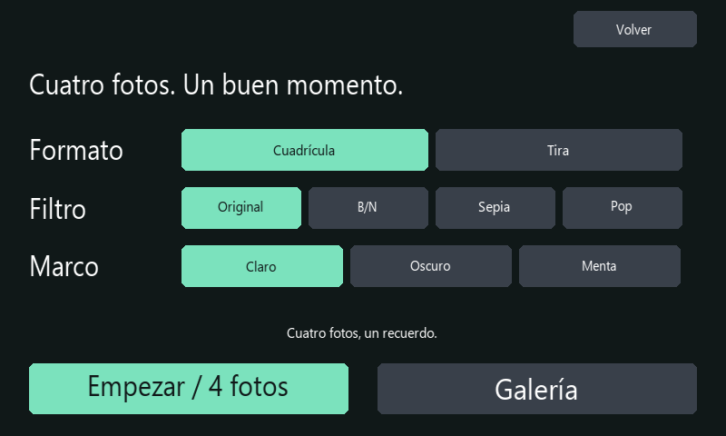

# Cabina de fotos

La cabina toma cuatro fotos con una cuenta regresiva de tres segundos antes de cada captura. Después crea una composición y conserva las cuatro imágenes originales. Requiere la cámara CSI conectada y el PIN del anfitrión.

1. Entra en **Estado → Cámara → Cabina**.
2. Elige **Cuadrícula** para una composición de dos por dos, o **Tira** para cuatro imágenes verticales.
3. Selecciona un filtro: **Original**, **B/N**, **Sepia** o **Pop**. Elige un marco **Claro**, **Oscuro** o **Menta**.
4. Coloca la cámara y pulsa **Empezar / 4 fotos**. Mira la cuenta y cambia de pose entre capturas. Cada foto tarda un tiempo adicional en exponerse y guardarse; la sesión completa suele superar los doce segundos de las cuentas regresivas.
5. Al terminar, pulsa **Ver composición**. En Galería encontrarás también los cuatro originales de 1280 × 720 píxeles.

La cuadrícula se guarda a 1352 × 844 píxeles; la tira, a 688 × 1612. Los efectos se aplican a la composición, sin modificar los originales. Puedes descargar cualquiera de los archivos desde el [panel del teléfono](TELEFONO.md).

**Detener**, **Volver** o bloquear el Hub cancela las capturas pendientes. Las fotos terminadas permanecen en la galería. No se genera una composición incompleta ni se reanuda la sesión automáticamente después de un reinicio.

La cabina reserva la cámara durante la sesión. No puede comenzar mientras hay un timelapse, una captura u otra operación de imagen en curso. Antes de iniciar se comprueba que haya margen dentro de los límites de 100 fotos y 250 MiB para cuatro originales y una composición. La papelera también ocupa espacio.

La pantalla muestra la cuenta y el número de fotos guardadas durante la sesión; el encuadre en directo se consulta antes de iniciar. No apuntes la cámara a otras personas sin avisarles de que vas a tomar fotografías.
