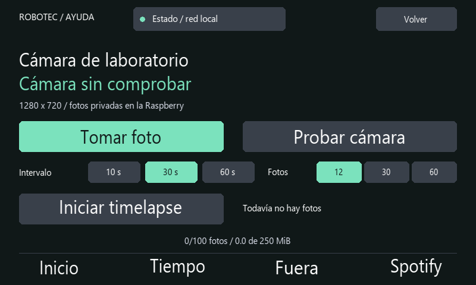

# Cámara: fotos y timelapse

La cámara permite tomar una foto manual o guardar una secuencia de fotos a intervalos desde **Estado → Cámara**. Las imágenes permanecen en la Pi. Para capturar necesitas el panel desbloqueado, una cámara CSI detectada y espacio libre; no hace falta conexión a internet.

## Conectar una cámara a la Pi 3 B

La Pi 3 B utiliza el conector CSI de 15 contactos. Una placa marcada REV 1.3 suele corresponder a Camera Module 1 con sensor OV5647; confirma el sensor mediante la detección del sistema. Las características y conectores se describen en la [documentación de hardware de Raspberry Pi](https://www.raspberrypi.com/documentation/accessories/camera.html).

1. Apaga Linux con `sudo systemctl poweroff` y espera a que termine. Desconecta la alimentación de la Pi y de la pantalla antes de manipular el equipo.
2. Localiza el conector **CAMERA/CSI** de la Pi, entre HDMI y Ethernet. No uses el conector de pantalla DSI.
3. Levanta con cuidado las dos pestañas del cierre CSI. Inserta el flex de 15 contactos recto y hasta el fondo: en la Pi 3 B, sus contactos metálicos miran hacia HDMI. Cierra ambas pestañas sin forzarlas.
4. Comprueba que el extremo de la cámara también está bien insertado, siguiendo la orientación de su conector. Evita tocar los contactos y doblar el flex sobre una arista.
5. Reconecta las fuentes y espera al arranque. No conectes ni retires el flex con la Pi alimentada.

Consulta las ilustraciones oficiales de [conexión del cable de cámara](https://www.raspberrypi.com/documentation/usage/camera/raspicam/raspivid.md?file=raspivid.md) si necesitas comprobar la orientación. La cámara se alimenta mediante CSI; no necesita una conexión al adaptador USB–TTL.

## Preparar el software

En Raspberry Pi OS, instala las herramientas de cámara si no están disponibles:

```sh
sudo apt update
sudo apt install rpicam-apps
rpicam-hello --list-cameras
```

El último comando enumera sensores; no guarda una foto. Un módulo OV5647 debe aparecer identificado como `ov5647`. Si no aparece ninguna cámara, apaga y revisa conexión, orientación y estado del flex antes de repetir. No habilites controladores de otro sensor por el texto REV de la placa. Consulta la [guía oficial de software e instalación](https://www.raspberrypi.com/documentation/accessories/camera-software.html) para configuración específica del módulo.

## Foto manual



Vista reconstruida con datos de demostración y tipografía aproximada.

Desbloquea el Hub y abre **Estado → Cámara**. Pulsa **Probar cámara** para comprobar la detección sin guardar imágenes. Después pulsa **Tomar foto**. Espera a que aparezca Foto guardada en la Raspberry antes de solicitar otra captura; se muestra el nombre del último archivo. Cada foto es un JPEG de 1280 × 720 píxeles. Copia la imagen al ordenador para revisar el resultado.

Orienta la cámara al objeto o experimento que quieres registrar. En un laboratorio compartido, informa a las personas presentes antes de fotografiarlas y evita incluir documentos o pantallas ajenos al experimento.

## Timelapse

Elige un intervalo de **10, 30 o 60 segundos** y una secuencia de **12, 30 o 60 fotos**. Pulsa **Iniciar timelapse**: la primera captura se solicita inmediatamente y las siguientes según el intervalo, sin solapar capturas. El Hub guarda imágenes JPEG individuales; no genera un vídeo. Puedes salir a otra vista mientras se completa.

**Detener timelapse** termina la secuencia. Bloquear el panel también cancela capturas pendientes y en curso; no se reanudan automáticamente al desbloquear o reiniciar. Iniciar Fuera bloquea el panel y detiene la secuencia. Para un timelapse largo, ajusta previamente los tiempos en **Estado → Pantalla y bloqueo** y vuelve a bloquear el Hub cuando termines. Entrar en Cámara o arrancar el servicio no toma fotos.

El almacenamiento está limitado a **100 imágenes o 250 MiB**. Cada captura necesita un margen de 8 MiB dentro de ese límite; al agotarlo, la secuencia se detiene. No se borran fotos automáticamente. Revisa el espacio disponible antes de comenzar y copia las imágenes que quieras conservar para liberar espacio cuando sea necesario. El límite de la aplicación no sustituye la comprobación de espacio libre de la microSD.

## Copiar las imágenes

Las capturas se guardan en `~/.local/share/desk-hub/camera` con la configuración predeterminada. Si ejecutas el panel con `--state-dir OTRA_RUTA`, estarán en `OTRA_RUTA/camera`. Los permisos son 700 para la carpeta y 600 para las imágenes. Solo la cuenta Linux propietaria y administradores del sistema pueden acceder normalmente a ellas. No se publican en GitHub ni se sirven mediante una página web. La función no transmite vídeo en directo.

Desde PowerShell en el ordenador, sustituye `USUARIO` e `IP_DE_LA_PI` por los del equipo y ejecuta:

```powershell
scp -r USUARIO@IP_DE_LA_PI:.local/share/desk-hub/camera ./fotos-hub
```

La carpeta `fotos-hub` se crea en el directorio actual. Si cambiaste `--state-dir`, ajusta también la ruta de origen del comando. Abre varias imágenes y comprueba que se copiaron correctamente antes de eliminar originales de la Pi. El acceso utiliza las credenciales SSH de Linux; el PIN de la pantalla no autoriza SSH.

## Comprobación inicial y límites

Antes de registrar un experimento, confirma detección, toma una foto, cópiala y revisa encuadre e iluminación. Después prueba una secuencia corta y comprueba que Detener y el bloqueo interrumpen las capturas. Una cámara detectada todavía puede fallar durante la captura por cableado, alimentación o permisos; verifica el resultado en el hardware que vas a utilizar.

El timelapse usa el reloj y servicio de la Pi y requiere que permanezca encendida. Las capturas consumen CPU y escriben en la microSD; la respuesta puede variar con la cámara y con otras funciones activas. No retires alimentación mientras se guarda una imagen.
