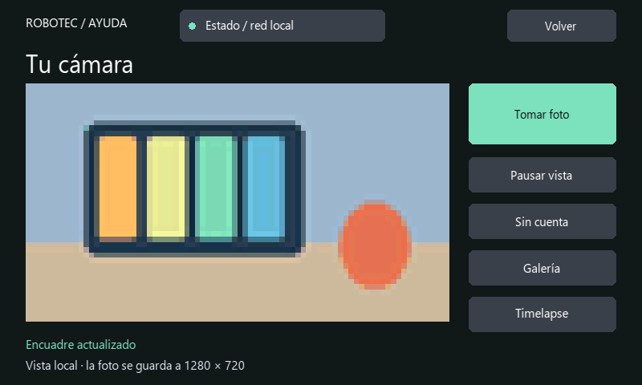
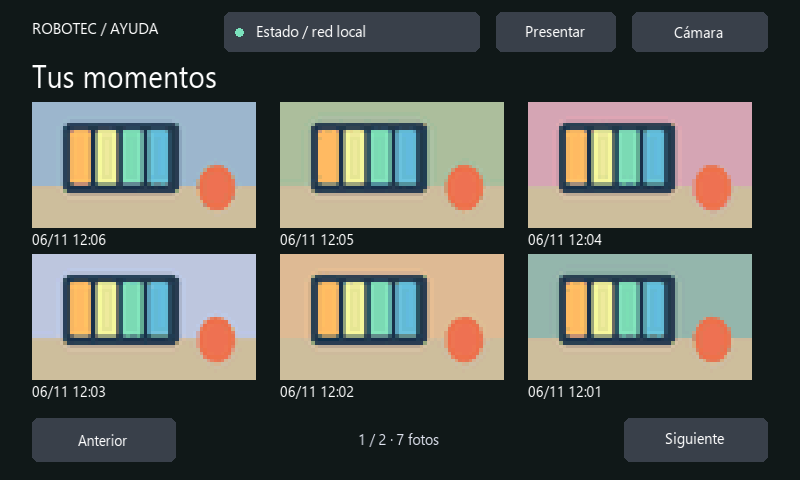
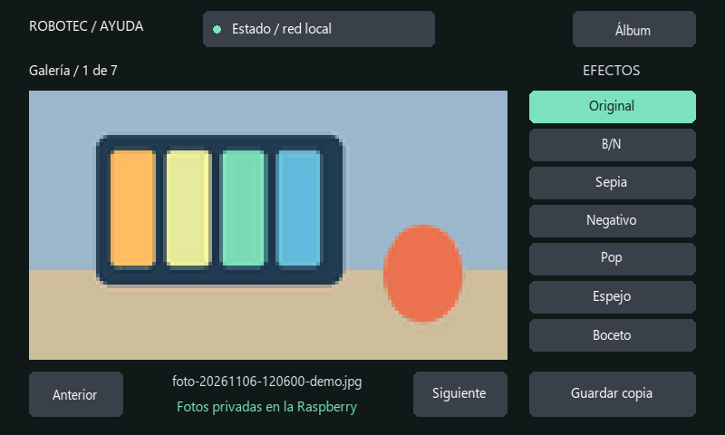
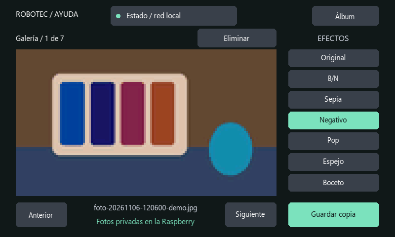
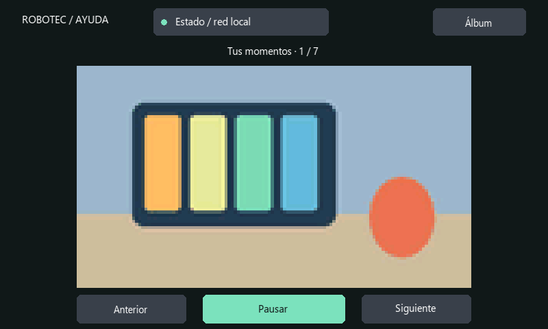
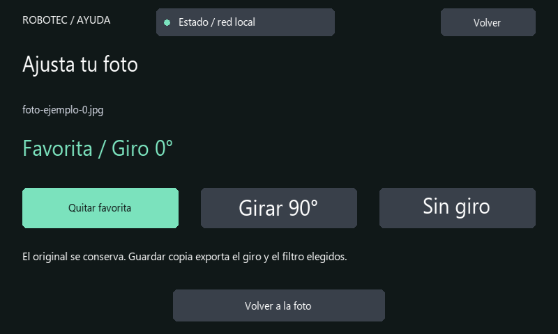
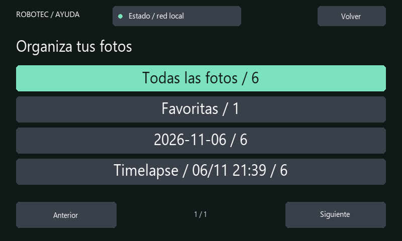
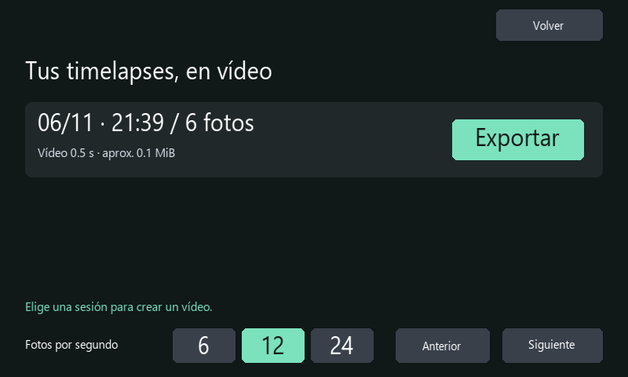

# Cámara: fotos, timelapse y galería

La cámara permite tomar una foto manual o guardar una secuencia de fotos a intervalos desde **Estado → Cámara**. Incluye encuadre continuo local, álbum de miniaturas, presentación y copias con efectos. Las imágenes permanecen en la Pi. Para capturar necesitas el panel desbloqueado, una cámara CSI detectada y espacio libre; no hace falta conexión a internet.

## Conectar una cámara a la Pi 3 B

La Pi 3 B utiliza el conector CSI de 15 contactos. Una placa marcada REV 1.3 suele corresponder a Camera Module 1 con sensor OV5647; confirma el sensor mediante la detección del sistema. Las características y conectores se describen en la [documentación de hardware de Raspberry Pi](https://www.raspberrypi.com/documentation/accessories/camera.html).

1. Apaga Linux con `sudo systemctl poweroff` y espera a que termine. Desconecta la alimentación de la Pi y de la pantalla antes de manipular el equipo.
2. Localiza el conector **CAMERA/CSI** de la Pi, entre HDMI y Ethernet. No uses el conector de pantalla DSI.
3. Levanta con cuidado las dos pestañas del cierre CSI. Inserta el flex de 15 contactos recto y hasta el fondo: en la Pi 3 B, sus contactos metálicos miran hacia HDMI. Cierra ambas pestañas sin forzarlas.
4. Comprueba que el extremo de la cámara también está bien insertado, siguiendo la orientación de su conector. Evita tocar los contactos y doblar el flex sobre una arista.
5. Reconecta las fuentes y espera al arranque. No conectes ni retires el flex con la Pi alimentada.

Consulta las ilustraciones oficiales de [conexión del cable de cámara](https://www.raspberrypi.com/documentation/usage/camera/raspicam/raspivid.md?file=raspivid.md) si necesitas comprobar la orientación. La cámara se alimenta mediante CSI; no necesita una conexión al adaptador USB–TTL.

## Preparar el software

En Raspberry Pi OS, instala las herramientas de cámara si no están disponibles:

```sh
sudo apt update
sudo apt install rpicam-apps
rpicam-hello --list-cameras
```

El último comando enumera sensores; no guarda una foto. Un módulo OV5647 debe aparecer identificado como `ov5647`. Si no aparece ninguna cámara, apaga y revisa conexión, orientación y estado del flex antes de repetir. No habilites controladores de otro sensor por el texto REV de la placa. Consulta la [guía oficial de software e instalación](https://www.raspberrypi.com/documentation/accessories/camera-software.html) para configuración específica del módulo.

## Encuadrar y tomar una foto



Vista reconstruida con una imagen sintética y tipografía aproximada.

1. Desbloquea el Hub y abre **Estado → Cámara**.
2. Pulsa **Activar cámara**. La cámara permanece abierta y actualiza el encuadre sin guardar fotografías. Las zonas quietas se conservan; al mover la cámara, espera a que termine de dibujarse la nueva imagen.
3. **Sin cuenta** cambia a **Cuenta: 3 s** si quieres un pequeño retardo antes de disparar. Pulsa otra vez para quitarlo.
4. Pulsa **Tomar foto**. La vista se pausa, se completa la cuenta elegida y se guarda un JPEG de **1280 × 720 píxeles**. El Hub abre la foto en el visor para revisarla o aplicarle un efecto.
5. **Álbum** vuelve a las miniaturas. Desde allí, **Cámara** permite preparar otra foto.

**Pausar vista** conserva el último encuadre en pantalla y detiene las actualizaciones. La imagen en pausa no representa lo que ocurre en ese instante. Salir de Cámara detiene el encuadre, y volver requiere pulsar Activar cámara. El modo ambiental también interrumpe el encuadre; bloquear cancela cualquier captura pendiente y limpia los datos de vista previa.

La cámara envía MJPEG de **640 × 360 a cuatro fotogramas por segundo** a un proceso local en memoria. La Nextion muestra una versión de **80 × 45 píxeles y hasta 128 colores**, conservando el encuadre más reciente y descartando los atrasados. La aplicación evita redibujar variaciones pequeñas de ruido respecto a la imagen ya mostrada. La velocidad visible depende de cuánto cambia la escena: una actualización pequeña puede terminar en una fracción de segundo; un cambio completo requiere aproximadamente dos segundos en el equipo de referencia. No equivale a vídeo fluido a pantalla completa.

Si `rpicam-vid` no está instalado, se usa `rpicam-still` por encuadres individuales, con una actualización más lenta. Las herramientas oficiales se describen en la [guía de software de cámara de Raspberry Pi](https://www.raspberrypi.com/documentation/accessories/camera-software.html#rpicam-vid).

El álbum usa miniaturas de **64 × 36**, y el visor y la presentación alcanzan **128 × 72**. Estas resoluciones pertenecen a la vista en pantalla: los JPEG guardados siguen siendo de **1280 × 720**. El enlace temporal del [panel del teléfono](TELEFONO.md), creado por el anfitrión, permite ver un encuadre de mayor resolución y descargar los originales por la red local.

Orienta la cámara al objeto o experimento que quieres registrar. En un laboratorio compartido, informa a las personas presentes antes de fotografiarlas y evita incluir documentos o pantallas ajenos al experimento.

## Timelapse

En **Estado → Cámara → Timelapse**, elige un intervalo de **10, 30 o 60 segundos** y una secuencia de **12, 30 o 60 fotos**. Pulsa **Iniciar timelapse**: la primera captura se solicita inmediatamente y las siguientes según el intervalo, sin solapar capturas. El Hub guarda imágenes JPEG individuales. Después puedes convertir una sesión en MP4 desde **Cámara → Vídeos**. Puedes salir a otra vista mientras se completa.

**Detener timelapse** termina la secuencia. Bloquear el panel también cancela capturas pendientes y en curso; no se reanudan automáticamente al desbloquear o reiniciar. Iniciar Fuera bloquea el panel y detiene la secuencia. Para un timelapse largo, ajusta previamente los tiempos en **Estado → Pantalla y bloqueo** y vuelve a bloquear el Hub cuando termines. Entrar en Cámara o arrancar el servicio no toma fotos.

El almacenamiento está limitado a **100 imágenes o 250 MiB**, contando fotos originales y copias con efectos. Cada captura o copia necesita un margen de 8 MiB dentro de ese límite; al agotarlo, la operación se detiene. No se borran fotos automáticamente. Revisa el espacio disponible antes de comenzar y copia las imágenes que quieras conservar para liberar espacio cuando sea necesario. El límite de la aplicación no sustituye la comprobación de espacio libre de la microSD.

## Galería y efectos

La galería requiere el PIN del anfitrión. Los códigos temporales de invitado no permiten acceder a fotografías ni cámara.







Vistas reconstruidas con una imagen sintética de demostración y tipografía aproximada; no muestran fotografías tomadas en el laboratorio.

Abre **Estado → Cámara → Galería** con el panel desbloqueado. El álbum muestra **seis miniaturas por página**, ordenadas de más reciente a más antigua, con fecha y hora. **Anterior** y **Siguiente** cambian de página. Toca una miniatura para abrir la foto y sus efectos. Dentro del visor, Anterior y Siguiente recorren las fotos; **Álbum** regresa a las miniaturas. Si todavía no hay fotos, vuelve a Cámara y toma una. Consultar la galería no inicia la cámara ni captura imágenes.

**Presentar** abre un marco de fotos privado. Cada foto permanece ocho segundos después de terminar de dibujarse, y al llegar a la última se vuelve a la primera. Puedes pausar, continuar o cambiar de foto manualmente. **Álbum** termina la presentación. La presentación respeta los tiempos de vista ambiental y bloqueo: no prolonga por sí sola la sesión desbloqueada.



Elige un efecto a la derecha para previsualizarlo:

| Opción | Resultado |
|---|---|
| Original | Foto sin efecto |
| B/N | Blanco y negro |
| Sepia | Tonos cálidos |
| Negativo | Colores invertidos |
| Pop | Color más intenso |
| Espejo | Reflejo horizontal |
| Boceto | Aspecto de dibujo |

Cambiar de efecto solo modifica la vista previa. **Guardar copia** crea un JPEG nuevo con el efecto elegido; el original permanece intacto. Selecciona un efecto distinto de Original o gira la foto desde Opciones para guardar una copia. La copia conserva las dimensiones de la foto de origen: las capturas del Hub son de 1280 × 720 píxeles. Antes de guardarla, espera a que termine una captura manual o detén el timelapse.

Las copias se guardan en la misma carpeta con nombres que empiezan por `efecto-`; las capturas comienzan por `foto-`. Ambas aparecen en la galería y cuentan para el límite de almacenamiento. Comprueba el mensaje de resultado antes de solicitar otra copia. El botón **Álbum** regresa a las miniaturas.

Nextion presenta una vista reducida que se dibuja progresivamente por UART. Puede tardar varios segundos en completarse y no representa el detalle del JPEG guardado; copia el archivo al ordenador para revisarlo a tamaño completo. Esta vista recorre fotos existentes, no es una vista en directo de la cámara. Bloquear limpia la vista previa y cancela trabajos pendientes de galería; las imágenes ya guardadas se conservan.

## Copiar las imágenes

Las capturas se guardan en `~/.local/share/desk-hub/camera` con la configuración predeterminada. Si ejecutas el panel con `--state-dir OTRA_RUTA`, estarán en `OTRA_RUTA/camera`. Los permisos son 700 para la carpeta y 600 para las imágenes. Solo la cuenta Linux propietaria y administradores del sistema pueden acceder normalmente a ellas. No se publican en GitHub. El anfitrión puede habilitar su descarga mediante el enlace temporal del teléfono. El encuadre se procesa en memoria.

Desde PowerShell en el ordenador, sustituye `USUARIO` e `IP_DE_LA_PI` por los del equipo y ejecuta:

```powershell
scp -r USUARIO@IP_DE_LA_PI:.local/share/desk-hub/camera ./fotos-hub
```

La carpeta `fotos-hub` se crea en el directorio actual. Si cambiaste `--state-dir`, ajusta también la ruta de origen del comando. Abre varias imágenes y comprueba que se copiaron correctamente antes de eliminar originales de la Pi. El acceso utiliza las credenciales SSH de Linux; el PIN de la pantalla no autoriza SSH.

## Comprobación inicial y límites

Antes de registrar un experimento, confirma detección, toma una foto, cópiala y revisa encuadre e iluminación. Después prueba una secuencia corta y comprueba que Detener y el bloqueo interrumpen las capturas. Una cámara detectada todavía puede fallar durante la captura por cableado, alimentación o permisos; verifica el resultado en el hardware que vas a utilizar.

El timelapse usa el reloj y servicio de la Pi y requiere que permanezca encendida. Las capturas consumen CPU y escriben en la microSD; la respuesta puede variar con la cámara y con otras funciones activas. No retires alimentación mientras se guarda una imagen.

## Favoritos, giros y grupos

En **Galería → Álbumes**, elige Todas, Favoritas, una fecha o una sesión de Cabina o Timelapse. Anterior, Siguiente y Presentar recorren únicamente el grupo elegido. Las fotos anteriores a la creación del catálogo siguen disponibles en Todas y por fecha; no se asignan automáticamente a una sesión.

Abre una foto y pulsa **Opciones** para marcarla como favorita, girarla 90° o quitar el giro. Estas preferencias se conservan al reiniciar y no reescriben el JPEG. **Guardar copia** crea un archivo con el giro y efecto visibles. Descargar el original entrega los bytes originales; para obtener el giro aplicado, descarga la copia guardada.





Vistas de demostración con imágenes sintéticas y tipografía aproximada.

## Crear un vídeo del timelapse

Instala el codificador en la Raspberry:

```sh
sudo apt install ffmpeg
```

1. Crea un timelapse y espera a que guarde al menos dos fotos. Puedes detenerlo antes de completar la cantidad elegida.
2. Detén la vista de cámara y abre **Estado → Cámara → Vídeos**.
3. Elige **6, 12 o 24 fotos por segundo** y pulsa Exportar junto a la sesión. Una secuencia de 60 fotos a 12 fotos/s produce un vídeo de 5 segundos; este valor es independiente del intervalo entre capturas.
4. Espera el mensaje **Vídeo listo**. El contador muestra los fotogramas enviados al codificador; al llegar al total puede faltar cerrar el MP4.
5. Enlaza el [teléfono](TELEFONO.md), abre **Fotos** y busca **Timelapses en vídeo** para descargar el MP4.



Vista de demostración con datos sintéticos y tipografía aproximada.

El vídeo es H.264, 1280 × 720, sin audio. Se añaden bandas cuando una foto tiene otra proporción. Los originales permanecen intactos. La duración calculada es exacta según el número de fotos y la velocidad; el tamaño mostrado es una estimación y varía con la escena.

Se exportan sesiones de 2 a 60 fotos. Si falta una imagen, restáurala de la papelera antes de exportar. Durante la exportación no se admiten capturas ni cambios de las fotos. **Cancelar exportación** o bloquear el Hub interrumpe el trabajo y conserva los originales; no se reanuda automáticamente tras un reinicio.

Cada MP4 admite hasta 32 MiB, con un presupuesto separado de 250 MiB para vídeos. Antes de comenzar se reservan 32 MiB y un margen de 100 MiB libres en la microSD. El codificador utiliza un hilo y tiene un límite de dos minutos. Si alcanza los límites o falla, el panel informa del error sin publicar un vídeo parcial.

Los MP4 se guardan en `~/.local/share/desk-hub/videos` y el catálogo privado de favoritos, giros y sesiones en `~/.local/share/desk-hub/photo-catalog.json`. La carpeta de vídeos tiene permisos 700 y sus archivos 600. Para liberar espacio de vídeo, descarga y verifica el archivo y después elimina ese MP4 concreto por SSH; la papelera de fotografías no gestiona vídeos.
