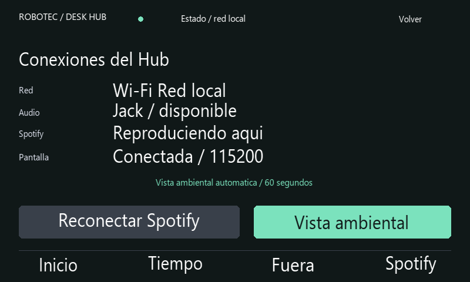

# Uso de la experiencia del Hub

## Música y vista ambiental

Desbloquea el panel y selecciona **Desk Hub Robotec** en la aplicación Spotify del teléfono. El Hub debe estar en la misma red local. El indicador distingue espera, sincronización, carga y reproducción local. El título o la portada pueden estar disponibles antes de que el traspaso de audio haya terminado.

Usa los iconos para anterior, pausa/reproducción y siguiente. La barra superior cambia la posición; la inferior cambia el volumen. Opciones contiene aleatorio, repetición y el siguiente tema. El fondo y el acento toman un color de la portada. Un título largo comienza a desplazarse tras una pausa inicial.

Tras **60 segundos sin tocar Inicio o Spotify**, aparece la vista ambiental con hora, portada y canción. Un toque fuera del botón de reproducción vuelve a la vista anterior y se consume: no activa un control que estuviera debajo. El botón circular sigue controlando pausa/reproducción. La vista ambiental conserva el acceso que ya estaba desbloqueado; utiliza Bloquear o Fuera para exigir nuevamente el PIN.

En **Estado** puedes abrir la vista ambiental de inmediato o tocar su ajuste para desactivar la entrada automática. El ajuste se conserva entre reinicios.

Vista reconstruida con datos de demostración y tipografía aproximada.

## Duración exacta

1. Abre Tiempo → Temporizador o la preparación de Fuera.
2. Toca la cifra central de minutos.
3. Introduce un entero entre **1 y 1440 minutos**.
4. Pulsa Guardar para preparar la duración. La cuenta comienza al pulsar Iniciar o Estoy fuera.

Borrar elimina el último dígito. Cancelar conserva la duración anterior. Los controles −/+ siguen disponibles para ajustes de un minuto.

## Aviso de salida

En la preparación de Fuera, toca el motivo para recorrer **Estoy fuera**, **En reunión** y **En el laboratorio**. Elige duración y pulsa Estoy fuera. El panel se bloquea, detiene Spotify y presenta la hora prevista de regreso junto a proyectos públicos de GitHub.

Al vencer la cuenta aparece **Regreso pendiente**: conserva la hora prevista, los proyectos públicos y el bloqueo. El PIN correcto termina la salida y permite preparar otra. Abrir el teclado o introducir un PIN incorrecto conserva el aviso. Ver aviso de regreso vuelve a la pantalla pública.

## Conexiones y recuperación

Toca **Estado** en el encabezado de una vista normal. El panel muestra el tipo de red local y su dirección IP, disponibilidad de audio, estado de Spotify y comunicación con la pantalla. El monitor se actualiza aproximadamente cada cinco segundos. El estado del flujo de audio es una comprobación del sistema operativo; no detecta parlantes apagados ni conectores físicos sueltos.

Si la reproducción queda atascada, pulsa **Reconectar Spotify**. Se reinicia el receptor, se descartan órdenes pendientes y debes seleccionarlo otra vez desde el teléfono. Esta acción mantiene la protección por PIN. Bloqueado o en Fuera, el panel no habilita el receptor.

Vista reconstruida con datos de demostración y tipografía aproximada.

## Avisos y música

El temporizador y la alarma tienen secuencias de tonos diferentes. Durante el aviso, el Hub reduce temporalmente el flujo de audio de Spotify al **22 % de su nivel anterior**; no modifica el nivel general de salida. Al detener, posponer o concluir el sonido restaura los niveles por canal. Si se cambia manualmente el volumen del flujo durante el aviso, conserva el cambio manual.

La alarma repite el aviso durante un máximo de tres minutos y el temporizador durante treinta segundos. Probar sonido dura cinco segundos. Los avisos funcionan con el panel bloqueado y no autorizan Spotify.

## Instalación de estas funciones

Las vistas y su lógica se ejecutan en Python en la Raspberry Pi. Se usa el HMI/TFT de referencia del repositorio; estas funciones no requieren volver a cargar la microSD de la pantalla. Mantén todos los módulos Python de la misma versión y reinicia el servicio después de actualizar el código.
