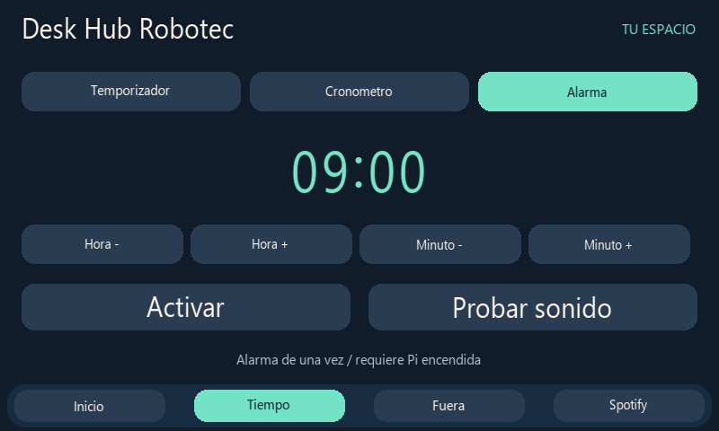
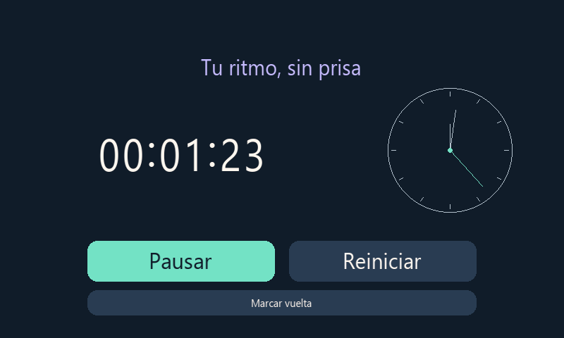

# Temporizador, cronómetro y alarma

## Temporizador

Selecciona un preset: 5 / Descanso, 25 / Enfoque, 45 o 60 minutos. Los botones inferiores ajustan la duración entre cero y 24 horas. Iniciar presenta una vista de cuenta grande. Pausar conserva lo restante; Reiniciar devuelve la duración configurada y detiene la cuenta. El temporizador comparte estado con Fuera: definir una nueva cuenta sustituye la anterior.

Al terminar aparece Tiempo cumplido y se reproduce un aviso breve por los parlantes. Aceptar cierra el aviso. El sonido utiliza `paplay` de PulseAudio, no Spotify. Funciona sin red si el audio y servicio están disponibles.

## Cronómetro

La cuenta y el reloj analógico representan tiempo transcurrido. El reloj pequeño no es la hora local. Puedes marcar vueltas sin detenerlo; se conservan las cinco últimas en SQLite y se muestra la más reciente. Pausar conserva el tiempo; Reiniciar borra cuenta y vueltas.

El cronómetro iniciado conserva el tiempo transcurrido durante un reinicio. El reloj de Linux debe ser correcto: una corrección brusca de hora puede afectar temporizadores basados en instantes guardados.

## Alarma

Ajusta hora y minuto y pulsa Activar. Si esa hora ya pasó, se programa para el día siguiente. Es una alarma de una sola ejecución: después de sonar debes activarla de nuevo si la necesitas otro día. Probar sonido reproduce el mismo aviso sin programar una alarma.

Al sonar, Aceptar cierra el aviso y Posponer 5 min crea una nueva alarma para cinco minutos después. Ambos controles están disponibles aun con el panel bloqueado, pero no desbloquean ni activan Spotify. El aviso permanece hasta que se atiende.

La programación se conserva en SQLite. Si el servicio se recupera hasta cinco minutos después de la hora, reproduce el aviso. Si pasó más tiempo, presenta Alarma vencida sin sonido. No enciende la Raspberry Pi apagada y no sustituye un despertador autónomo: requiere Pi encendida, servicio activo, hora correcta y salida de audio operativa. Si la conexión USB–TTL impide arrancar el servicio, tampoco puede gestionar avisos hasta recuperarse.

Vistas reconstruidas con datos de demostración y tipografía aproximada; no son fotografías de la pantalla.
