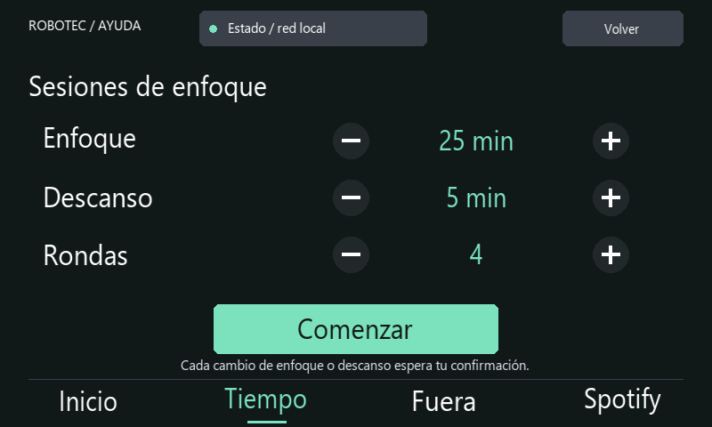
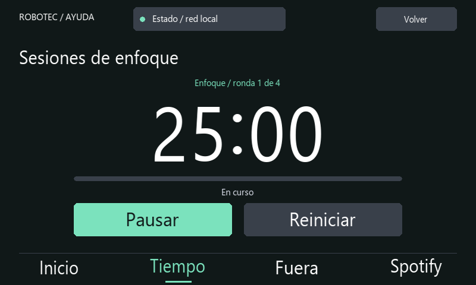

# Temporizador, cronómetro, alarma y sesiones

## Temporizador

Elige 5 minutos de descanso, 25 de enfoque o una hora con los accesos bajo la cifra central. Los botones − y + ajustan un minuto por toque, entre 1 minuto y 24 horas. Toca la cifra central para introducir una duración exacta de 1 a 1440 minutos y pulsa Guardar; esto prepara la cuenta sin iniciarla. Cancelar conserva la duración anterior. Iniciar presenta una vista de cuenta grande. Pausar conserva lo restante; Continuar reanuda la cuenta y Reiniciar devuelve la duración configurada. Al pausar se muestran también los segundos restantes. El temporizador comparte estado con Fuera: definir una nueva duración sustituye la cuenta anterior.

Inicio vuelve a la portada sin detener la cuenta; toca la tarjeta del temporizador para abrirla de nuevo. Al terminar aparece Tiempo cumplido y el aviso se repite hasta pulsar Detener, durante un máximo de treinta segundos. El temporizador tiene una secuencia de dos tonos y la alarma una secuencia de tres. El sonido utiliza `paplay` de PulseAudio. Durante el aviso se reduce temporalmente el flujo de Soloist; se restaura su nivel al detenerlo, posponerlo o vencer su límite de sonido, siempre que no se haya cambiado manualmente. Funciona sin red si el audio y servicio están disponibles.

## Cronómetro

La cuenta y el reloj analógico representan tiempo transcurrido. El reloj pequeño no es la hora local. Puedes marcar vueltas sin detenerlo; se conservan las cinco últimas en SQLite y se muestra la más reciente. Inicio vuelve a la portada sin detener el cronómetro. Su tarjeta permite recuperarlo. Pausar conserva el tiempo; Reiniciar borra cuenta y vueltas.

El cronómetro iniciado conserva el tiempo transcurrido durante un reinicio. El reloj de Linux debe ser correcto: una corrección brusca de hora puede afectar temporizadores basados en instantes guardados.

## Alarma

Toca las horas o los minutos para seleccionar qué ajustar; la parte seleccionada aparece en verde. Usa −/+ y pulsa Activar alarma. Si esa hora ya pasó, se programa para el día siguiente. La programación es de una sola ejecución: debes activarla de nuevo si la necesitas otro día.

La barra Volumen del aviso ajusta un nivel de 20 a 100 %, independiente del volumen de Spotify. El nivel general de la salida y el control físico de los parlantes también afectan lo que se escucha. Probar sonido reproduce el aviso durante cinco segundos sin programar la alarma.

Cuando llega la hora, las tres notas se repiten con una pausa corta entre secuencias. Detener silencia el aviso; Posponer 5 min lo silencia y programa otro para cinco minutos después. La repetición tiene un límite de tres minutos y el aviso visual permanece hasta atenderlo. Ambos controles funcionan con el panel bloqueado, pero no desbloquean ni activan Spotify.

Silenciar corta el sonido y conserva el aviso visible; Detener lo cierra. Ninguna acción cancela un temporizador o cronómetro independiente.

La programación se conserva en SQLite. Si el servicio se recupera hasta cinco minutos después de la hora, reproduce el aviso. Si pasó más tiempo, presenta Alarma vencida sin sonido. No enciende la Raspberry Pi apagada y no sustituye un despertador autónomo: requiere Pi encendida, servicio activo, hora correcta y salida de audio operativa. Si la conexión USB–TTL impide arrancar el servicio, tampoco puede gestionar avisos hasta recuperarse.

## Sesiones de enfoque

Abre **Tiempo → Sesiones** para preparar una secuencia de enfoque y descansos. Los controles −/+ ajustan tres valores:

| Ajuste | Intervalo | Valor inicial |
|---|---|---|
| Enfoque | 5–90 minutos | 25 minutos |
| Descanso | 1–30 minutos | 5 minutos |
| Rondas | 1–8 | 4 |

Pulsa **Comenzar**. Se muestran fase, ronda, tiempo restante y progreso. Pausar conserva lo restante y Continuar reanuda la misma fase. Reiniciar devuelve la sesión a los ajustes. Puedes salir mediante Inicio sin detenerla; su botón de cuenta permite volver a la sesión.

Al vencer una fase aparece un aviso. **Ver sesión** abre la cuenta y silencia el sonido; **Silenciar** corta el sonido y mantiene el aviso. El sonido dura un máximo de treinta segundos y utiliza el volumen configurado en Alarma. En la sesión, pulsa **Iniciar descanso** o **Iniciar enfoque** para continuar. Después del último enfoque, **Finalizar** muestra las rondas y minutos completados. No se añade un descanso tras la última ronda y ninguna fase empieza automáticamente.

Las sesiones son independientes del temporizador, cronómetro y Fuera. Bloquear no cancela la fase en curso, pero requiere introducir el PIN antes de avanzar a la siguiente. Puedes detener un aviso sin desbloquear el panel. Si otro aviso está visible al terminar una fase, el de enfoque espera a que cierres el anterior.

La configuración y el estado se guardan en SQLite. Una fase en marcha conserva su instante final durante un reinicio; si venció, queda esperando confirmación. Si se recupera más de cinco minutos tarde, se muestra el aviso sin sonido. La Pi necesita permanecer encendida para avisar a tiempo y tener la hora correcta. Una vez completada la sesión, Repetir sesión inicia otra con los mismos valores y Ajustar sesión vuelve a su configuración.

Vistas reconstruidas con datos de demostración y tipografía aproximada; no son fotografías de la pantalla.
