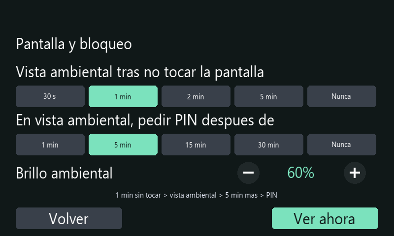

# Uso compartido del Desk Hub Robotec

## Primera vez

1. Conecta tu teléfono a la misma red local que el Hub.
2. Introduce el PIN en la pantalla. Solicítalo a la persona responsable del equipo.
3. Para música, abre Spotify en tu teléfono, entra a Dispositivos y selecciona Desk Hub Robotec.

Puedes utilizar tu propia cuenta de Spotify. No necesitas la contraseña de la Raspberry ni la clave de desarrollo que arranca el receptor.

**Ayuda** está disponible incluso antes de desbloquear. Desde las vistas normales, toca **ROBOTEC / AYUDA**. La guía funciona sin internet y no autoriza la reproducción.

Vista reconstruida con tipografía aproximada.

## Dejarlo listo para otra persona

- **Bloquear** cierra el acceso y detiene la música del Hub. La siguiente persona necesita el PIN.
- Si el Hub permanece desbloqueado, otras personas de la red pueden intentar conectarse desde Spotify. El PIN habilita el receptor completo y no identifica a cada teléfono.
- La **vista ambiental** muestra hora, música y la cuenta de tiempo activa. Mientras no haya vencido el plazo para pedir PIN, un toque fuera del botón de música recupera los controles. Después del bloqueo, necesitas el PIN.
- **Fuera** publica una hora de regreso y proyectos públicos de GitHub, mantiene el bloqueo y detiene Spotify. El PIN correcto termina la salida.

## Vista ambiental y bloqueo por inactividad

Abre **Estado → Pantalla y bloqueo** o **Spotify → Opciones → Pantalla y bloqueo**. Ajusta dos intervalos:

| Ajuste | Opciones | Valor inicial |
|---|---|---|
| Activar la vista ambiental después de no tocar la pantalla | 30 segundos, 1 minuto, 2 minutos, 5 minutos o Nunca | 1 minuto |
| Pedir el PIN después de entrar en la vista ambiental | 1, 5, 15 o 30 minutos, o Nunca | 5 minutos |

Con los valores iniciales, **1 minuto sin tocar la pantalla** abre la vista ambiental; **5 minutos más sin tocarla** bloquean el Hub. Son **6 minutos de inactividad total**. La reproducción de Spotify y los controles del teléfono no reinician esta cuenta: se mide la interacción con la pantalla del Hub.

Antes del bloqueo, toca fuera del botón de reproducción para recuperar los controles. El botón de música permite pausar o reproducir conservando la vista ambiental; ese toque reinicia el plazo para pedir PIN. Al bloquearse, se detiene el receptor de música y el panel pide el PIN. Las cuentas del temporizador, cronómetro y alarmas se conservan. Los avisos de alarma no suspenden el bloqueo automático ni desbloquean el panel.

**Nunca** en el primer ajuste desactiva la entrada automática a la vista ambiental y, por tanto, su bloqueo automático posterior. Puedes entrar manualmente mediante **Ver ahora**; en ese caso se aplica el intervalo de PIN elegido. **Nunca** en el segundo ajuste mantiene accesible la vista ambiental hasta que se bloquee manualmente o se active Fuera.

El **brillo ambiental** se ajusta entre **20 y 100 %**; inicialmente es **60 %**. El brillo de las vistas normales es del **100 %**. Los ajustes se conservan entre reinicios. **Ver ahora** permite comprobarlos sin esperar.

Vista reconstruida con tipografía aproximada.

## Usar otra pantalla mientras corre una cuenta

En el temporizador o cronómetro ampliado, **Inicio** vuelve a la portada sin detenerlo. La tarjeta de la cuenta permite recuperarla. Pausar conserva lo transcurrido o restante; Reiniciar devuelve la cuenta a su estado inicial.

Cuando aparece un aviso, **Silenciar** detiene el sonido y mantiene el aviso visible. **Detener** lo cierra. **Posponer 5 min** programa otra alarma. Estos controles no desbloquean el panel ni cancelan otras cuentas independientes.

## Consultar el clima

En Inicio, toca el bloque de clima para ver las próximas tres horas. Las filas muestran hora local, temperatura y probabilidad de precipitación. La cifra grande sigue siendo la temperatura actual. Vuelve a tocar para recuperar sensación térmica, humedad y viento.

## Si la música no se escucha

Abre **Estado** para revisar red y audio. Antes de reconectar, comprueba que Spotify tiene seleccionado el Hub y que los parlantes están encendidos. **Reconectar Spotify** reinicia el receptor; si está reproduciendo o cargando música, pide confirmación para evitar interrumpirla con un toque accidental.
