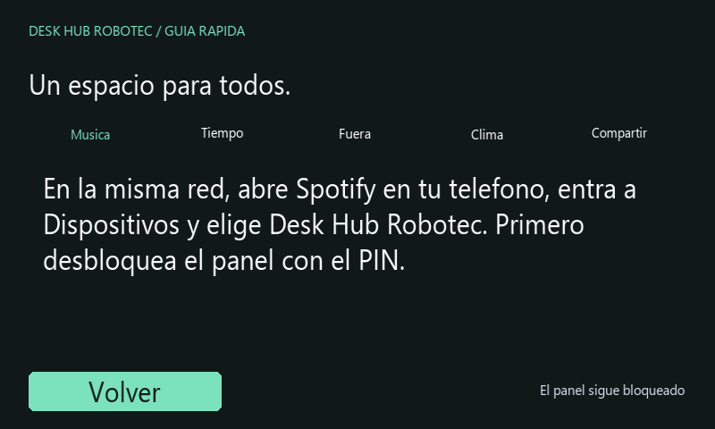

# Uso compartido del Desk Hub Robotec

## Primera vez

1. Conecta tu teléfono a la misma red local que el Hub.
2. Introduce el PIN en la pantalla. Solicítalo a la persona responsable del equipo.
3. Para música, abre Spotify en tu teléfono, entra a Dispositivos y selecciona Desk Hub Robotec.

Puedes utilizar tu propia cuenta de Spotify. No necesitas la contraseña de la Raspberry ni la clave de desarrollo que arranca el receptor.

**Ayuda** está disponible incluso antes de desbloquear. Desde las vistas normales, toca **ROBOTEC / AYUDA**. La guía funciona sin internet y no autoriza la reproducción.

Vista reconstruida con tipografía aproximada.

## Dejarlo listo para otra persona

- **Bloquear** cierra el acceso y detiene la música del Hub. La siguiente persona necesita el PIN.
- Si el Hub permanece desbloqueado, otras personas de la red pueden intentar conectarse desde Spotify. El PIN habilita el receptor completo y no identifica a cada teléfono.
- La **vista ambiental** muestra hora y música; conserva el estado desbloqueado. Un toque recupera los controles.
- **Fuera** publica una hora de regreso y proyectos públicos de GitHub, mantiene el bloqueo y detiene Spotify. El PIN correcto termina la salida.

## Cierre programado

En **Spotify → Opciones**, selecciona **15 min**, **30 min** o **60 min**. La cuenta comienza desde ese momento y se muestra sobre las opciones. **Sin cierre** cancela la programación.

Al vencer, se bloquea el panel y se detiene el receptor del Hub. El temporizador, el cronómetro y las alarmas conservan sus estados. El cierre no apaga la Raspberry Pi ni la pantalla. Para volver a escuchar, introduce el PIN y selecciona el Hub desde Spotify.

Un bloqueo manual cancela el cierre pendiente. Si el servicio se reinicia, conserva el instante programado y arranca bloqueado.

## Usar otra pantalla mientras corre una cuenta

En el temporizador o cronómetro ampliado, **Inicio** vuelve a la portada sin detenerlo. La tarjeta de la cuenta permite recuperarla. Pausar conserva lo transcurrido o restante; Reiniciar devuelve la cuenta a su estado inicial.

Cuando aparece un aviso, **Silenciar** detiene el sonido y mantiene el aviso visible. **Detener** lo cierra. **Posponer 5 min** programa otra alarma. Estos controles no desbloquean el panel ni cancelan otras cuentas independientes.

## Consultar el clima

En Inicio, toca el bloque de clima para ver las próximas tres horas. Las filas muestran hora local, temperatura y probabilidad de precipitación. La cifra grande sigue siendo la temperatura actual. Vuelve a tocar para recuperar sensación térmica, humedad y viento.

## Si la música no se escucha

Abre **Estado** para revisar red y audio. Antes de reconectar, comprueba que Spotify tiene seleccionado el Hub y que los parlantes están encendidos. **Reconectar Spotify** reinicia el receptor; si está reproduciendo o cargando música, pide confirmación para evitar interrumpirla con un toque accidental.
